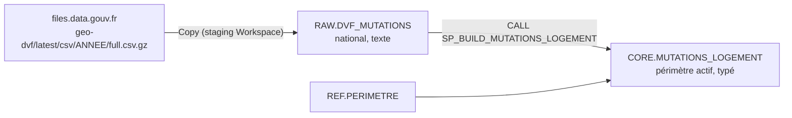

# Étape 2 — DVF dans Snowflake

Objectif : charger les fichiers DVF géolocalisées nationaux dans `FONCIER.RAW.DVF_MUTATIONS`, puis construire `FONCIER.CORE.MUTATIONS_LOGEMENT` sur le périmètre de `FONCIER.REF.PERIMETRE` (Normandie au départ).



RAW est national : changer de périmètre ne demande aucun rechargement, seulement une mise à jour de `REF.PERIMETRE` et un nouvel appel de la procédure.

## 1. Préparer Snowflake

Exécuter dans l'ordre, dans Snowsight :

1. `snowflake/01_raw_dvf.sql` — schéma REF, périmètre normand, table RAW.
2. `snowflake/02_core_mutations_logement.sql` — table CORE et procédure.

## 2. Vérifier l'en-tête du fichier

Télécharger un petit fichier, par exemple `https://files.data.gouv.fr/geo-dvf/latest/csv/2025/departements/76.csv.gz`, et lire la première ligne.

Le mapping (`docs/pl_bronze_dvf_mapping.json`) suppose des colonnes de lots nommées `lot1_numero`, `lot1_surface_carrez`… Certaines documentations écrivent `lot_1_numero`. Si l'en-tête réel diffère, corriger uniquement les noms `source` du mapping : les tables Snowflake ne changent pas.

Repérer aussi les années disponibles dans `https://files.data.gouv.fr/geo-dvf/latest/csv/` : la publication couvre cinq ans glissants, avec une première et une dernière année partielles.

## 3. Créer le pipeline `pl_bronze_dvf_snowflake`

Dans `immo-dev`, dossier `bronze`.

### Connexion HTTP

*Manage connections and gateways* → nouvelle connexion **HTTP** `cnx_http_geo_dvf` :

| Champ | Valeur |
| --- | --- |
| URL de base | `https://files.data.gouv.fr/geo-dvf/latest/csv/` |
| Authentification | Anonymous |

### Paramètre du pipeline

| Nom | Type | Valeur par défaut |
| --- | --- | --- |
| `p_annees` | Array | `["2021","2022","2023","2024","2025","2026"]` |

Pour le premier essai, lancer avec `["2025"]` seulement.

### Activités

```
fe_annees (ForEach, séquentiel)
  └── cp_dvf_annee (Copy)
sc_build_core (Script) — après fe_annees, sur succès
```

**`fe_annees`** — ForEach, *Sequential* coché, *Items* : `@pipeline().parameters.p_annees`.

**`cp_dvf_annee`** — Copy, dans le ForEach :

| Onglet | Réglage | Valeur |
| --- | --- | --- |
| Général | Retry / intervalle | 2 / 60 s |
| Source | Connexion | `cnx_http_geo_dvf` |
| Source | Relative URL | `@concat(item(), '/full.csv.gz')` |
| Source | Format | DelimitedText : séparateur virgule, *First row as header*, compression **gzip**, encodage UTF-8, guillemet `"` |
| Source | Additional columns | voir tableau suivant |
| Destination | Connexion | `cnx_snowflake_loader` |
| Destination | Base / schéma / table | `FONCIER` / `RAW` / `DVF_MUTATIONS` |
| Destination | Version / Write behavior | 1.1 / Insert |
| Destination | Pre-copy script | `DELETE FROM FONCIER.RAW.DVF_MUTATIONS WHERE ANNEE_FICHIER = '@{item()}'` |
| Mapping | — | coller `docs/pl_bronze_dvf_mapping.json` (voir plus bas) |
| Settings | Enable staging | coché, type **Workspace** |

Colonnes additionnelles (Source → Advanced → Additional columns, en contenu dynamique) :

| Nom | Valeur |
| --- | --- |
| `ANNEE_FICHIER` | `@item()` |
| `SOURCE_URL` | `@concat('https://files.data.gouv.fr/geo-dvf/latest/csv/', item(), '/full.csv.gz')` |
| `DATE_CHARGEMENT` | `@formatDateTime(utcNow(), 'yyyy-MM-dd HH:mm:ss')` |
| `ID_EXECUTION` | `@pipeline().RunId` |

Le staging est obligatoire : la copie directe vers Snowflake n'accepte comme source qu'un stockage Azure Blob. Avec le type **Workspace**, Fabric utilise son stockage intégré, sans compte de stockage à créer.

**Mapping.** Le plus fiable : ouvrir le JSON du pipeline (bouton *View JSON code* / `{}`), et remplacer le bloc `translator` de l'activité `cp_dvf_annee` par celui de `docs/pl_bronze_dvf_mapping.json`. Il associe les 40 colonnes du CSV (minuscules) et les 4 colonnes additionnelles aux colonnes RAW (MAJUSCULES), sans dépendre d'une correspondance de noms sensible à la casse.

**`sc_build_core`** — Script, connexion `cnx_snowflake_loader`, type **Query** :

```sql
CALL FONCIER.CORE.SP_BUILD_MUTATIONS_LOGEMENT();
```

Le type Query renvoie le résultat de la procédure dans la sortie de l'activité (`lignes_source`, `lignes_mergees`, `lignes_supprimees`).

## 4. Exécuter et contrôler

1. Lancer avec `p_annees = ["2025"]`. En cas d'échec de colonne, corriger le mapping (section 2).
2. Lancer avec toutes les années.
3. Exécuter `snowflake/03_controles_dvf.sql`.
4. Relancer le pipeline une seconde fois : les volumes RAW doivent être identiques, et la procédure doit renvoyer `lignes_mergees = 0` et `lignes_supprimees = 0`.
5. Commit depuis `immo-dev`, pull request `dev → main`.

**Étape 2 terminée quand** : volumes RAW stables entre deux chargements, procédure idempotente, prix médians au m² plausibles par département, et 5 ventes de l'échantillon retrouvées sur [app.dvf.etalab.gouv.fr](https://app.dvf.etalab.gouv.fr/).

## Coût

Chaque chargement réveille `WH_IMMO_XS` le temps des COPY et de la procédure, puis l'auto-suspend le coupe après 60 s. Le suivi se fait dans *Admin → Cost Management* ou avec :

```sql
SELECT WAREHOUSE_NAME, SUM(CREDITS_USED) AS CREDITS
FROM SNOWFLAKE.ACCOUNT_USAGE.WAREHOUSE_METERING_HISTORY
WHERE START_TIME >= DATEADD(day, -7, CURRENT_TIMESTAMP())
GROUP BY WAREHOUSE_NAME;
```

`ACCOUNT_USAGE` a quelques heures de latence ; à lancer avec `ACCOUNTADMIN`.
