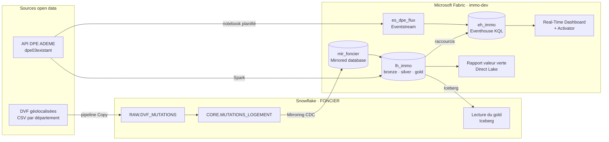

# Valeur verte — prix immobiliers et DPE avec Fabric et Snowflake

Combien vaut une meilleure étiquette énergétique ? Ce projet rapproche les ventes immobilières (DVF) des diagnostics de performance énergétique (DPE de l'ADEME) pour mesurer l'écart de prix au m² entre classes A à G, par territoire et dans le temps.

C'est un projet d'apprentissage Microsoft Fabric (préparation DP-700) qui fait cohabiter deux plateformes : **Snowflake** tient les ventes, **Fabric** les récupère par Mirroring, les rapproche des DPE en **Spark**, les explore et les surveille en **KQL**, et les restitue dans **Power BI**.

## Sommaire

- [Architecture](#architecture)
- [Stack](#stack)
- [Sources de données](#sources-de-données)
- [Structure du dépôt](#structure-du-dépôt)
- [Mise en place (étape 1)](#mise-en-place-étape-1)
- [Conventions](#conventions)
- [Avancement](#avancement)
- [Décisions et qualité des données](#décisions-et-qualité-des-données)
- [Coûts et garde-fous](#coûts-et-garde-fous)

## Architecture



Snowflake reste la source des ventes. Le Lakehouse porte le travail lourd (ingestion DPE, appariement ventes ↔ DPE, gold). L'Eventhouse sert l'analytique (séries temporelles, géospatial H3) et le flux quasi temps réel des nouveaux DPE. En fin de chaîne, Snowflake relit le gold en Iceberg.

## Stack

| Brique | Usage |
| --- | --- |
| Snowflake (trial Enterprise, Azure) | Chargement DVF, nettoyage SQL, relecture du gold en Iceberg |
| Fabric Mirroring | Réplication CDC de `CORE.MUTATIONS_LOGEMENT` vers OneLake |
| Fabric Lakehouse + Spark (PySpark) | Ingestion DPE, silver, appariement, gold |
| Fabric Data Factory | Pipeline de chargement DVF et orchestration `pl_main` |
| Eventstream, Eventhouse, KQL | Flux des nouveaux DPE, séries temporelles, cartes H3 |
| Activator | Alerte sur une hausse anormale de passoires F/G |
| Power BI (Direct Lake) | Rapport valeur verte |
| GitHub | Intégration Git des workspaces Fabric, scripts Snowflake |

## Sources de données

| Source | Producteur | Accès | Fraîcheur |
| --- | --- | --- | --- |
| [DVF géolocalisées](https://www.data.gouv.fr/datasets/demandes-de-valeurs-foncieres-geolocalisees/) | DGFiP, Etalab | `files.data.gouv.fr/geo-dvf` — CSV gzip par année et département | Semestrielle, 5 ans glissants |
| [DPE logements existants depuis juillet 2021](https://www.data.gouv.fr/datasets/dpe-logements-existants-depuis-juillet-2021/) | ADEME | API data-fair de `data.ademe.fr` (jeu `dpe03existant`) | Hebdomadaire |
| Code officiel géographique | INSEE | CSV | Annuelle |
| [Référentiel national des bâtiments](https://rnb.beta.gouv.fr/) (bonus) | IGN, beta.gouv | API et exports | Continue |

Périmètre : développement sur la Normandie (départements 14, 27, 50, 61, 76), puis France entière. DVF ne couvre ni l'Alsace, ni la Moselle, ni Mayotte.

**Aucune donnée n'est versionnée dans ce dépôt.** Les conditions d'utilisation de DVF interdisent notamment de rendre les données indexables par les moteurs de recherche ; les fichiers restent dans OneLake et Snowflake.

## Structure du dépôt

```
.
├── README.md
├── .gitignore
├── snowflake/              Scripts SQL Snowflake, numérotés dans l'ordre d'exécution
│   └── 00_setup.sql        Warehouses, resource monitor, base FONCIER, rôles, utilisateurs de service
└── fabric/                 Dossier Git des workspaces Fabric (écrit par Fabric, ne pas éditer à la main)
    ├── admin/              nb_utils, lh_admin, journal d'exécution
    ├── bronze/
    ├── silver/
    ├── gold/
    └── rti/                Eventstream, Eventhouse, querysets KQL, Real-Time Dashboard
```

## Mise en place (étape 1)

### 1. Snowflake

1. Créer un trial sur [signup.snowflake.com](https://signup.snowflake.com) : édition Enterprise, cloud **Azure**, région européenne la plus proche de la capacité Fabric.
2. Générer une paire de clés RSA par utilisateur de service (Git Bash ou WSL sous Windows). Les clés vont dans `keys/`, ignoré par Git :

   ```bash
   mkdir -p keys && cd keys
   openssl genrsa 2048 | openssl pkcs8 -topk8 -inform PEM -out rsa_loader.p8 -nocrypt
   openssl rsa -in rsa_loader.p8 -pubout -out rsa_loader.pub
   openssl genrsa 2048 | openssl pkcs8 -topk8 -inform PEM -out rsa_mirror.p8 -nocrypt
   openssl rsa -in rsa_mirror.p8 -pubout -out rsa_mirror.pub
   ```

3. Coller le contenu des deux fichiers `.pub` (sans les lignes `BEGIN` / `END`) dans `snowflake/00_setup.sql`, puis exécuter le script dans une worksheet Snowsight.
4. Noter l'identifiant de compte renvoyé à la fin du script (`<org>-<compte>.snowflakecomputing.com`) : c'est le serveur des connexions Fabric.

### 2. GitHub

1. Créer le dépôt avec deux branches : `main` (stable) et `dev` (travail courant).
2. Créer un jeton d'accès personnel *fine-grained*, limité à ce dépôt, avec la permission **Contents : Read and write**.

### 3. Fabric

1. Créer les workspaces `immo-dev` et `immo-test` sur la capacité d'essai.
2. Dans chaque workspace : *Workspace settings → Git integration → GitHub*, ajouter le compte (nom, jeton, URL du dépôt), puis :

   | Workspace | Branche | Dossier Git |
   | --- | --- | --- |
   | `immo-dev` | `dev` | `fabric` |
   | `immo-test` | `main` | `fabric` |

3. Dans `immo-dev`, créer les dossiers `admin`, `bronze`, `silver`, `gold`, `rti`.
4. Créer `lh_admin` dans `admin` et `lh_immo` (avec schémas) dans `gold` ; dans `lh_immo`, créer les schémas `bronze`, `silver`, `gold`.
5. Reprendre `nb_utils` du projet énergie (export `.ipynb` depuis l'ancien workspace, import dans `admin`), le rattacher à `lh_admin` et recréer la table `log_execution`.
6. Réglages Spark repris du projet énergie : starter pool, expiration des sessions à 10 minutes.
7. Créer les connexions Snowflake (*Manage connections and gateways*), authentification **Key pair**, noms en MAJUSCULES comme dans Snowflake :

   | Connexion | Utilisateur | Warehouse | Usage |
   | --- | --- | --- | --- |
   | `cnx_snowflake_loader` | `SVC_FABRIC_LOADER` | `WH_IMMO_XS` | Pipeline de chargement DVF |
   | `cnx_snowflake_mirror` | `SVC_FABRIC_MIRROR` | `WH_MIRROR_XS` | Mirroring (étape 3) |

8. Commit depuis `immo-dev`, pull request `dev → main`, puis *Update all* dans `immo-test`.

**Étape 1 terminée quand** : les deux connexions Snowflake passent le test, `nb_utils` écrit une ligne dans `lh_admin.dbo.log_execution`, et `immo-test` est à jour depuis `main`.

## Conventions

| Préfixe | Élément | Exemple |
| --- | --- | --- |
| `lh_` | Lakehouse | `lh_immo` |
| `mir_` | Mirrored database | `mir_foncier` |
| `nb_<couche>_` | Notebook | `nb_silver_dpe` |
| `pl_` | Pipeline | `pl_main`, `pl_bronze_dvf_snowflake` |
| `es_`, `eh_`, `kql_` | Eventstream, Eventhouse, queryset | `es_dpe_flux`, `eh_immo` |
| `sm_`, `rpt_`, `rtd_` | Modèle sémantique, rapport, Real-Time Dashboard | `sm_valeur_verte` |

- Côté Snowflake, tous les objets sont en MAJUSCULES : Fabric compare les noms de warehouse en respectant la casse.
- Chaque table gold est écrite via `publier()` de `nb_utils` : contrôles bloquants avant écriture, ligne dans le journal.
- Branches : travail sur `dev`, fusion vers `main` par pull request à la fin de chaque étape.

## Avancement

- [ ] 1. Mise en place (Snowflake, GitHub, workspaces, connexions)
- [ ] 2. DVF dans Snowflake (`RAW` → `CORE.MUTATIONS_LOGEMENT`)
- [ ] 3. Mirroring Snowflake → Fabric
- [ ] 4. DPE en bronze et silver (Spark)
- [ ] 5. Appariement ventes ↔ DPE (Spark)
- [ ] 6. Gold, valeur verte, passage au national
- [ ] 7. KQL et flux temps réel, Power BI, relecture du gold par Snowflake

## Décisions et qualité des données

| Date | Sujet | Décision | Raison |
| --- | --- | --- | --- |
| | | | |

## Coûts et garde-fous

- **Snowflake** : warehouses XS avec auto-suspend à 60 s, resource monitor `RM_IMMO` qui suspend à 90 % du quota. Le Mirroring interroge Snowflake en continu et ne se planifie pas : arrêter la réplication entre deux sessions de travail.
- **Fabric** : capacité d'essai ; développement sur la Normandie avant tout passage au national.
- **Secrets** : clés privées dans `keys/` (ignoré par Git), jamais dans un notebook.

## Licence

Code sous licence MIT. Les données restent soumises aux conditions de leurs producteurs (DGFiP, ADEME, INSEE).
